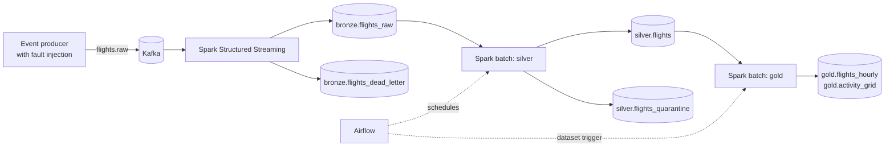

# Modern Data Platform

[](https://github.com/leosoares96/modern-data-platform/actions/workflows/ci.yml)
[](https://github.com/leosoares96/modern-data-platform/actions/workflows/integration.yml)

A lakehouse you can run on your laptop with Docker. Synthetic flight events flow through **Kafka** into
**Apache Iceberg** tables on S3-compatible storage, are refined through **bronze, silver and gold** layers
with **Spark**, and are orchestrated by **Airflow**.

It is a study project. The goal is to practise the problems that show up in real data platforms rather than
the happy path: duplicates, late data, malformed payloads, idempotent reprocessing, data quality, table
maintenance and orchestration.

## How it works



- **Producer.** Generates ADS-B-like events (position, altitude, speed) and can deliberately duplicate them,
  delay them or corrupt them in four different ways.
- **Bronze.** A streaming job parses every Kafka message. Valid events are appended to an Iceberg table;
  everything else goes to a dead-letter table with the raw payload and the reason.
- **Silver.** An incremental batch job deduplicates with `MERGE INTO`, applies business rules, quarantines the
  rows that break them, flags late arrivals and runs data quality checks.
- **Gold.** Hourly aggregates per airline and a one-degree activity grid, rebuilt only for the hours that changed.
- **Orchestration.** Airflow runs silver on a schedule and gold whenever silver publishes its dataset.

More detail in [docs/architecture.md](docs/architecture.md).

## Run it

You need Docker and, for the full stack, about 10 GB of memory available to it
(see the [runbook](docs/runbook.md) for smaller profiles and for Windows/WSL2 settings).

```bash
git clone https://github.com/leosoares96/modern-data-platform.git
cd modern-data-platform
scripts/demo.sh
```

The demo starts from a clean state, produces 400 events with injected faults, runs every stage and asserts
the result of each one. It is the same script CI runs on every push. Afterwards:

```bash
make sql Q="SELECT airline, count(*) AS rows FROM lake.silver.flights GROUP BY airline"
make sql Q="SELECT reason, count(*) FROM lake.bronze.flights_dead_letter GROUP BY reason"
```

| Service | URL |
| --- | --- |
| Spark master | http://localhost:8080 |
| Airflow | http://localhost:8088 (`admin` / `admin`) |
| Object store console | http://localhost:9001 (`minioadmin` / `minioadmin`) |
| Iceberg REST catalog | http://localhost:8181/v1/config |

## What is verified

Everything below is exercised by CI. `scripts/demo.sh` runs the whole stack on a GitHub Actions runner and
fails if any assertion breaks.

| Capability | How it is checked |
| --- | --- |
| Events reach Kafka | Exactly the number of messages produced is on the topic |
| Bronze streaming ingestion | Every message ends up in bronze or in the dead-letter table, both non-empty |
| Dead-letter routing | Unparseable, incomplete and mistyped payloads are kept with their reason |
| Silver deduplication | One row per `event_id` even though duplicates were injected |
| Business rules and quarantine | Impossible values land in quarantine, and `valid + quarantined = distinct events` |
| Idempotent reprocessing | A second silver run inserts nothing; a second gold run does not double count |
| Data quality | Checks are persisted in `quality.check_results`; an error-severity failure fails the job |
| Iceberg features | Time travel, rollback, schema and partition evolution, each asserted |
| Maintenance | Compaction and snapshot expiry leave every table's row count unchanged |
| Airflow | DAG integrity tests, tasks run through Airflow, and gold starts by itself when silver publishes its dataset |

There are 60 unit tests (event generation and fault injection, Kafka batch parsing, business rules,
deduplication, quality checks, catalog configuration, DAG structure). The Spark ones run on a real local
Spark session.

## Layout

```
producer/adsb/     event generator and Kafka producer
spark/lakehouse/   shared code: session, DDL, schemas, transformations, quality checks
spark/streaming/   bronze streaming job
spark/batch/       silver, gold and maintenance jobs
spark/admin/       table initialisation, verification and SQL helpers
spark/demo/        Iceberg time travel and evolution walkthrough
airflow/dags/      silver, gold and maintenance DAGs
docker/            Spark and Airflow images
scripts/           demo, bootstrap, topic creation, job submission
docs/              architecture, runbook, roadmap and decision records
tests/             unit tests
```

## Design decisions

Each choice that is expensive to reverse has a short record in [docs/decisions](docs/decisions/README.md):
Compose profiles for small machines, Iceberg, the REST catalog, a community MinIO fork, at-least-once bronze
with idempotent silver, merge-on-read, and the missing S3A connector.

## Limitations

This is a single-node local environment, not a production design.

- Delivery into bronze is at least once. Silver removes the duplicates ([ADR 0006](docs/decisions/0006-at-least-once-bronze-idempotent-silver.md)).
- Streaming checkpoints live on a local Docker volume, and orphan file removal is not run, because the image
  has no S3A connector ([ADR 0008](docs/decisions/0008-no-s3a-connector.md)).
- Credentials are fixed development values, nothing uses TLS, and Airflow runs its scheduler and web server
  in one container.
- The object store is a community fork of MinIO, since upstream stopped publishing images
  ([ADR 0005](docs/decisions/0005-s3-compatible-object-store.md)).
- Data is synthetic. The schema follows OpenSky state vectors so a real source could be plugged in.

## What is next

See the [roadmap](docs/roadmap.md): serving the gold tables with Trino and a dashboard, and a separate
repository that ports these jobs to AWS (Glue catalog, S3, Terraform).

## License

[MIT](LICENSE)
