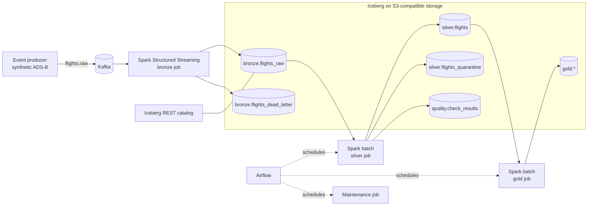

# Architecture

A local lakehouse. Synthetic flight events flow through Kafka into Apache Iceberg tables on an
S3-compatible object store, are refined through bronze, silver and gold layers with Spark, and are
orchestrated by Airflow.

## Layers

| Layer | Table | Contents |
| --- | --- | --- |
| Bronze | `lake.bronze.flights_raw` | Parsed events exactly as received, plus Kafka coordinates. Append only. |
| Bronze | `lake.bronze.flights_dead_letter` | Payloads that could not be parsed, with the reason. |
| Silver | `lake.silver.flights` | Deduplicated, validated, typed events. Upserted with `MERGE INTO`. |
| Silver | `lake.silver.flights_quarantine` | Parsed events that broke a business rule. |
| Quality | `lake.quality.check_results` | One row per check per run. |
| Gold | `lake.gold.*` | Aggregates ready for analysis. |

## Delivery semantics

Bronze is **at least once**: a restarted streaming batch can write the same rows again. Silver absorbs
that by deduplicating on `event_id`, so the end result is effectively once.

## Status

See the status table in the [README](../README.md). Components are marked *implemented* only when the
CI integration workflow exercises them.
